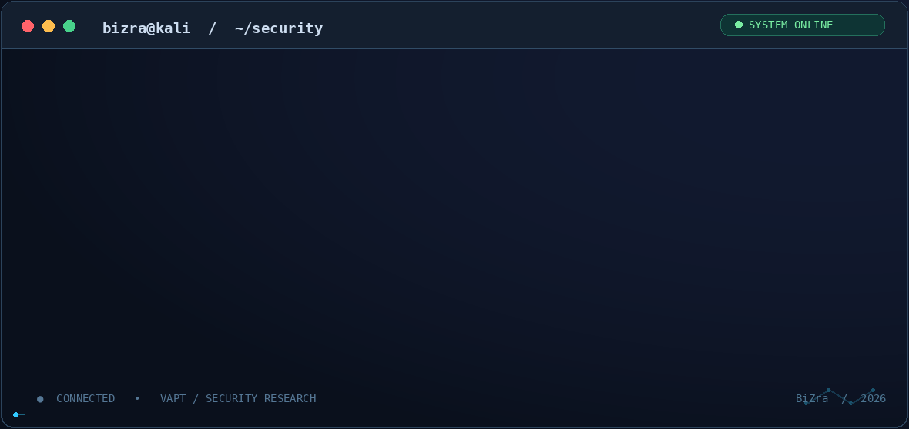

# Hi, I'm Raheela Shabbir 👋

### `BiZra` | Cybersecurity Researcher · Penetration Tester · Secure Backend Developer

**Breaking down security challenges. Building more resilient systems.**

---

## `whoami`

  

*BiZra · Offensive security, vulnerability research, secure development and applied AI/ML.*

## About Me

I'm a cybersecurity professional and researcher with **3+ years of research and development experience** at the **National Center for Cyber Security (NCCS / NASTP)**. My work brings together offensive security, secure backend engineering, and applied AI/ML research.

- 🛡️ **Offensive security:** Vulnerability Assessment & Penetration Testing (VAPT), web application security, network assessments, and technical reporting.
- 💻 **Development:** Python, Flask, FastAPI, REST APIs, database engineering, and secure application development.
- 🔎 **Analysis & research:** Network forensics, threat hunting, digital forensics, NLP, and computer vision.
- 🎓 **Education:** M.S. Cyber Security — Air University, Islamabad.
- 🎯 **Focus:** Applying an attacker's mindset to design stronger defenses and better security tooling.

## Core Technical Skills

| Area | Tools & Practices |
| :--- | :--- |
| **Penetration Testing** | Kali Linux, Nmap, Burp Suite, Metasploit, OWASP ZAP, Nessus, SQLMap |
| **Web & Network Security** | OWASP Top 10, SQLi, XSS, authentication testing, service enumeration, vulnerability assessment |
| **Forensics & Detection** | Wireshark, TShark, Snort, network traffic analysis, OSINT, IOC analysis |
| **Secure Development** | Python, Flask, FastAPI, REST APIs, MySQL, Linux, Git, RBAC |
| **AI / ML** | Scikit-learn, TensorFlow, Keras, spaCy, NLTK, OpenCV, Pandas, NumPy |
| **Frameworks** | MITRE ATT&CK, threat hunting, security reporting, ISO/IEC 27001 |

## Featured Work

**Web Application Security Assessment**  
Manual and tool-assisted testing of web applications, with vulnerability validation, risk-focused documentation, and remediation recommendations.

**Network Traffic Analysis & Threat Detection**  
Packet inspection and threat analysis with Wireshark, TShark, and Snort to identify suspicious patterns and indicators of compromise.

**Secure Alumni Portal**  
Python and MySQL-based platform using REST APIs, role-based access control, input validation, and automated data workflows.

**AI / NLP & Digital Forensics Research**  
Projects involving multilingual OCR, sentiment analysis, transfer learning, and ML-ready data pipelines.

📂 **Explore project details and technical experience:** [**My Cybersecurity Portfolio**](https://bizra-portfolio.vercel.app/)

## Certifications & Professional Training

| Credential | Issuer |
| :--- | :--- |
| **Certified Penetration Testing Professional (CPENT)** | EC-Council |
| **Certified Ethical Hacker (CEH)** | NAVTTC / Corvit Rawalpindi |
| **ISO/IEC 27001:2022 Information Security Associate** | SkillFront |
| OPSWAT Network Security Associate (ONSA) | OPSWAT Academy |
| Introduction to Critical Infrastructure Protection (ICIP) | OPSWAT Academy |
| Foundations of Threat Hunting | Purple Academy / Picus Security |
| MITRE ATT&CK Training | Purple Academy / Picus Security |
| Assets, Threats, and Vulnerabilities | Google / Coursera |

## Cybersecurity Community & CTFs

- **5th Digital Pakistan Cybersecurity Hackathon** — Participation, **18–20 September 2026**; advanced workshop, **15–16 October 2026**.
- **NineByte CTF 2026** — Certificate of achievement.
- **BlitzStorm CTF** — Participation.
- **Hackerverse DFIR CTF** — Participation.
- Active on **TryHackMe** and **Hack The Box**, exploring web exploitation, forensics, reverse engineering, and other security challenges.

## Let's Connect

- 🌐 **Portfolio:** https://bizra-portfolio.vercel.app/
- 💼 **LinkedIn:** [Raheela Shabbir](https://linkedin.com/in/raheela-satti-751a64173)
- 🎯 **TryHackMe:** [BiZra](https://tryhackme.com/p/BiZra)
- 📦 **Hack The Box:** [Profile](https://profile.hackthebox.com/profile/019d8a9d-4e81-73a5-96ad3b583e676c36)
- ✉️ **Email:** [raheelasatti5@gmail.com](mailto:raheelasatti5@gmail.com)

---

Security research · VAPT · Secure development · Continuous learning

